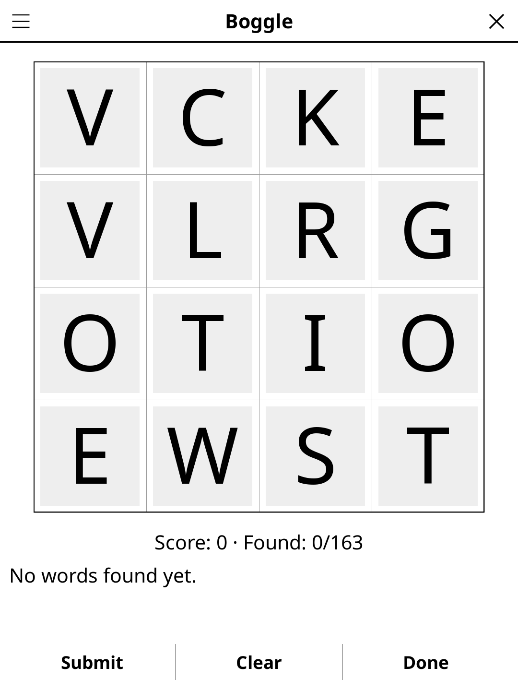

# boggle.koplugin

A Boggle-style word search plugin for [KOReader](https://github.com/koreader/koreader).

## Screenshot

## Rules

Find words by connecting adjacent letters (horizontally, vertically, or diagonally) in the letter grid. Each letter may be used only once per word. Words must be at least 3 letters long. Longer words score more points — race against the clock!

## Concept

Find as many words as possible in a 4×4 grid of letters by connecting adjacent
letters (including diagonals). Each letter may only be used once per word.
Longer words score more points.

## Features

- **Grid sizes** — 4×4 (classic), 5×5 (extended)
- **Two languages** — EN (105,145 words) and FR (132,778 words), both 3-9 letters
- **Word validation** — against a bundled dictionary for the chosen language (English uses [ENABLE](https://github.com/dolph/dictionary), the Public-Domain word-game list; French is a CC0 Scrabble-valid list)
- **Scoring** — standard Boggle scoring (3 letters = 1 pt, up to 8+ letters = 11 pts)
- **Timer** — configurable countdown (1, 2 or 3 minutes) or untimed mode
- **Word list** — found words listed alphabetically with scores
- **End reveal** — shows all valid words missed after the timer expires
- **High scores** — best scores stored per language and grid size

## Controls

| Action | How |
|--------|-----|
| Start a word path | Tap the first letter |
| Extend the path | Tap adjacent letters in sequence |
| Submit word | Tap **Submit** or re-tap the last letter |
| Cancel current word | Tap **Cancel** |
| New game | Tap **New game** |
| Change language | Menu → **Language: EN** |
| Multiplayer | Menu → **Mode: Solo** → Multiplayer |
| Show rules | Tap **Rules** |

## Multiplayer ("Boggle · multiplayer")

**Boggle Party is now "Boggle · multiplayer"**: the separate Boggle Party
plugin (`boggleparty.koplugin`) is retired, and everything it did lives here.
Open it from **Tools → Games → Party & quiz → Boggle · multiplayer** (FR:
« Boggle · à plusieurs »), or switch with **Mode: Multiplayer** in the game's
menu. On the first multiplayer launch, Boggle Party's language, duration and
timer choice are imported (its settings file is only read, never changed).

Lay the reader in the middle of the table; everyone plays on paper.

- **Large grid** — letters fill the screen, readable from across the table,
  portrait or landscape; the grid stays blank until **Start round**.
- **Countdown** — 2, 3, 4 or 5 minutes (**Duration** in the menu, which also
  shows/hides the timer); only the timer area refreshes, once a second.
  **Pause / Resume** during the round; a round interrupted by closing the game
  comes back paused.
- **Auto-reveal at zero** (or **Solutions** / **Show solution**): every word
  of the grid, grouped by length with the totals.
- **Scoring helper** — players read their lists aloud and cross out every word
  someone else also found. Then, player by player, tap the length of each word
  left (**3–4**, **5**, **6**, **7**, **8+**): the reader adds up the standard
  points. **Undo** removes the last tap or goes back to the previous player;
  **Next player**, then **End round** adds the round to the scores.
- **Match** — 2 to 8 players (names remembered), 1 to 10 rounds; a scoreboard
  after each round, the winner (or tie) at the end, then **New game**.
- **EN / FR** word lists (Language in the menu, separate from the solo game's).

| Length | 3 | 4 | 5 | 6 | 7 | 8+ |
|--------|---|---|---|---|---|----|
| Points | 1 | 1 | 2 | 3 | 5 | 11 |

## Why e-ink friendly?

Letter selection is tap-based and discrete. The grid and word list are static
between taps, so e-ink refresh is only triggered on each new letter tap.

## License

GPL-3.0
